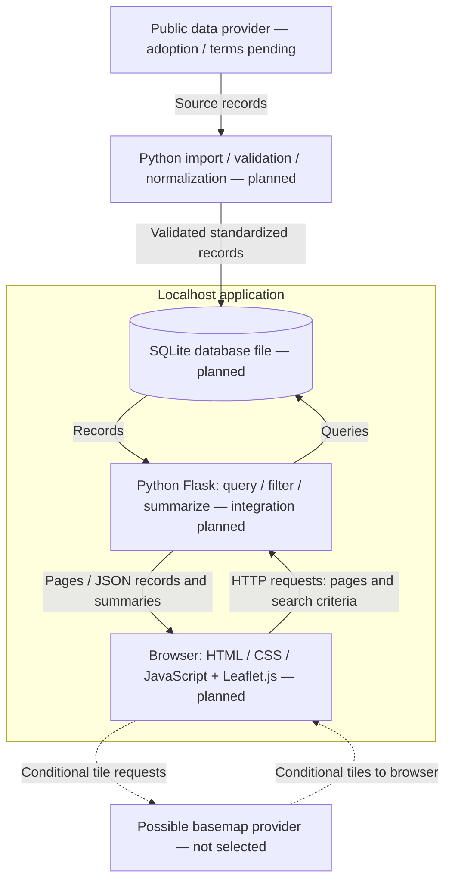
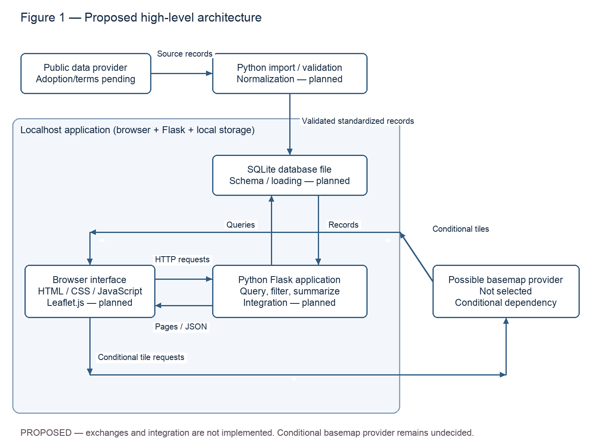

> Epics: #3, #14, #12 · Stories: #4, #5, #28, #15, #16, #13, #21, #22
> Documentation tasks: #66, #60 · Owner: Mike · Status: proposed; independent review pending

# High-level system architecture

Figure 1 answers which components cooperate and what runs locally. The agreed stack is Python Flask, SQLite, Leaflet.js, and HTML/CSS/JavaScript on localhost. All arrows describe planned exchanges. The import process is separate from interactive searches; no live provider request per search is assumed.

*Figure 1 — Proposed high-level architecture. The import box sits outside the interactive application boundary; it is local preparation tooling, not a hosted service. The static export uses the same exchanges as the Mermaid source.*

## Contracts and implementation evidence

- Source preparation follows [Crime Data Sources](../crime-data-sources.md) (#4, #8, #9) and [Standardized Crime Data Format](../crime-data-format.md) (#5, #10, #11). Final source adoption and reuse terms remain open. Calls for service retain their meaning and source precision.
- SQLite schema, loading, and retrieval are planned under #32, #35, #36 / Story #28. The format specification is not a physical database schema.
- Flask will validate user criteria, retrieve candidate records, apply area and other filters, and produce records and summaries for the browser. Route names, payloads, error handling, and query optimization remain unspecified; the diagram does not invent an API contract.
- `prototype/area_filter.py` (#17) uses decimal-degree coordinates and a radius in miles. `prototype/crime_frequency.py` (#18) summarizes selected records. Their standalone synthetic tests do not verify database or browser integration. The standardized `incident_date`/`incident_time` fields need an adapter or reviewed interface change because frequency code currently reads other timestamp names.
- Browser map setup/data/markers belong to #23, #24, #27 / #13; filters and radius belong to #21 and #22. The browser receives application data from Flask; it does not directly query SQLite.
- A basemap provider is a conditional external dependency, not Leaflet itself. Provider, attribution, terms, connectivity, and offline behavior must be decided before implementing tile access. Neither a geocoder nor a public deployment is assumed.

The localhost plan limits deployment work for the prototype. SQLite avoids a separate database server, but suitability for a larger deployment has not been evaluated. Snapshot preparation makes demonstrations repeatable but requires visible data age and coverage. These rationale statements are draft design explanations for team review, not measured performance findings.

For Figure 2's external boundary, see [System context](system-context.md). ER, DFD, and sequence diagrams remain separate work. PNG exports can be regenerated with `python docs/design/render_diagrams.py` after installing Pillow in a temporary environment; keep its graph data synchronized with the editable Mermaid when revising a figure. Both views require human review before submission.
