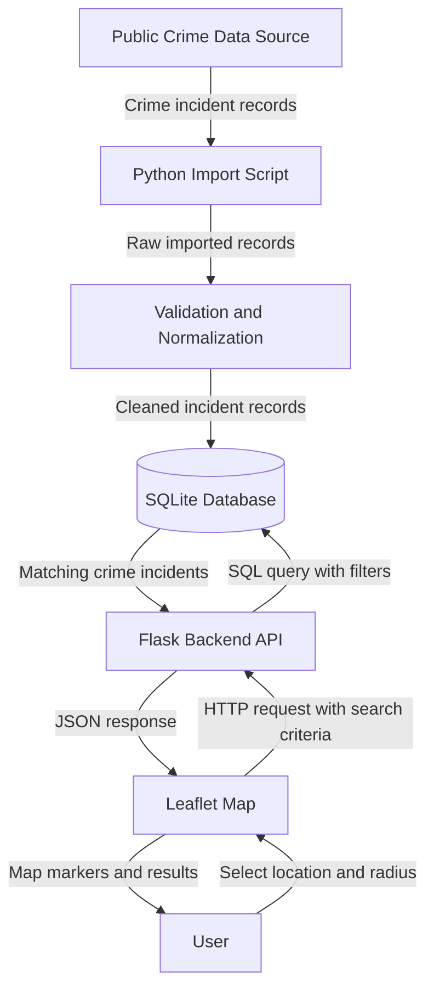

# Sprint 2 — Crime Data Flow Diagram (DFD)

> Epic: #3. Stories: #4, #5. Task: #69

This diagram shows the planned flow of public crime data through the Crime-Busters application.

**Note:** This diagram represents the planned Sprint 2 architecture. Exact API routes, data fields, and filtering implementation should be verified against the application code.
