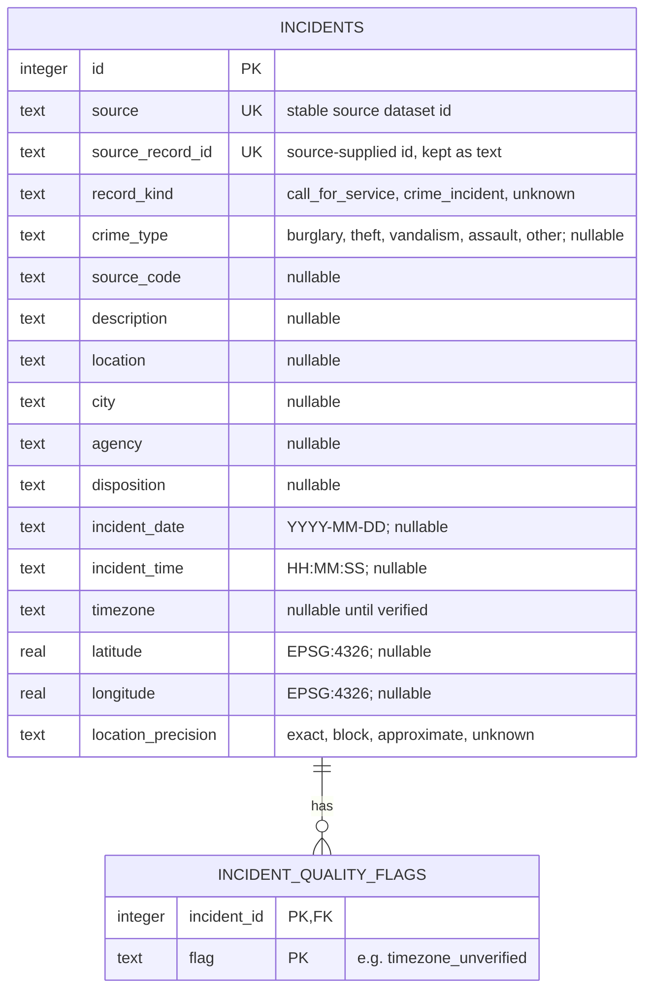

> Epic: #3 · Story: #28 · Task: #32 (schema); related: #5, #10, #11, #35, #36

# Crime Database ER Diagram

This document describes the initial SQLite schema for standardized crime
incident records. It is a design for review, not evidence that records have
been loaded. The fields come from version 1 of the
[Standardized Crime Data Format](../crime-data-format.md); the executable
schema is [`prototype/schema.sql`](../../prototype/schema.sql).

## Entity-relationship diagram

## Design notes

- **Identity.** `(source, source_record_id)` is unique, matching validation
  rule 7. A conflicting second version of a record is rejected by the
  database, so the loader must flag it for review instead of overwriting it.
- **Quality flags.** The format's `quality_flags` array becomes the child
  table `incident_quality_flags`, so records can be queried by flag. A record
  with no flags has no child rows.
- **Coordinates.** Latitude and longitude are both present and in range, or
  both NULL (validation rule 5). Missing coordinates are never stored as 0.
  Records without coordinates cannot appear in radius results.
- **Dates and times.** Stored as ISO text and checked with SQLite's
  `date()` and `time()` functions. Invalid values are stored as NULL with
  an `invalid_date` or `invalid_time` flag.
- **Source values.** Original codes, descriptions, locations and
  dispositions are stored as supplied. A call for service is not a confirmed
  crime; `record_kind` keeps that distinction visible.
- **Excluded records.** Records missing `source` or `source_record_id` are
  held for correction and never enter the database (validation rule 1).

## Open questions for the team

- Whether `quality_flags` should stay a child table or become a JSON text
  column.
- Whether the flag vocabulary should be enforced by the database or by the
  loader.
- Whether a `sources` table is needed once a second dataset is adopted.
- Reuse terms for the Costa Mesa data remain unresolved; see
  [Crime Data Sources](../crime-data-sources.md).
