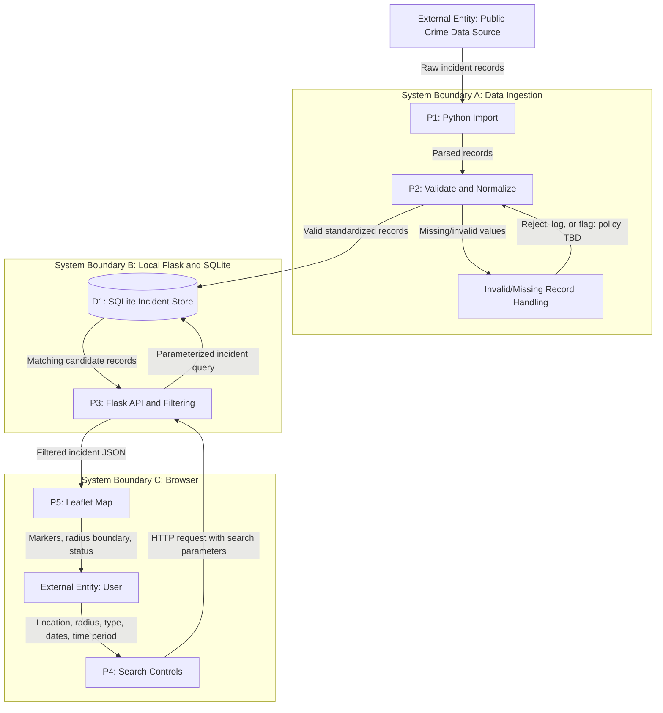

# Sprint 2 — Crime Data Flow Diagram (DFD)

> Epic: #3, #12. Stories: #4, #5, #28, #21, #13, #22. Task: #69.

**Figure 1. Proposed Crime-Busters data flow:** Public crime data is imported, validated, normalized, stored in SQLite, queried through Flask, and displayed as incident markers on a Leaflet map.

**Legend:** Rectangles represent external entities or processes; the cylinder represents the SQLite data store; arrows show the direction of exchanged data; subgraphs represent system boundaries.

## Data fields and normalization

Proposed incident fields include:

- Incident identifier: source identifier or generated unique identifier (TBD).
- Crime type: standardized incident category.
- Location: latitude and longitude, when available.
- Date/time: standardized timestamp when supplied.
- Additional source metadata: retained according to the agreed data format.

During import, the Python script parses source records and normalizes field names, crime categories, coordinates, and date/time values.

Records with missing or invalid coordinates, identifiers, or dates require validation. The final reject, quarantine, or partial-record policy remains TBD. Invalid records must not silently become valid map markers.

Supporting documentation:

- [Crime data sources](../crime-data-sources.md)
- [Crime data format](../crime-data-format.md)

## Interactive filtering

The browser sends selected latitude, longitude, radius, optional crime type, date range, and time-period filters to the Flask backend.

Flask validates the request, retrieves candidate incidents from SQLite, and applies the relevant filters, including geographic distance and the selected time criteria.

Only matching incidents with usable map coordinates are returned to Leaflet for display as markers. The selected search radius is shown as a map boundary.

Exact API endpoint names, SQL schema, distance algorithm, radius units, and boundary-inclusion behavior are proposed details pending agreement (TBD). These are documented further in the [radius search sequence diagram](radius-search-sequence.md).

## Proposed integration and assumptions

This figure describes the planned integration of public crime data, a Python import pipeline, SQLite storage, Flask filtering, and the Leaflet interface. It is not evidence that all components are currently integrated.

The public data provider, source schema, final validation rules, endpoint paths, and database implementation details must be confirmed against the team's source and format documentation.

Related design: [Architecture and system context](architecture.md), #66.

Related tasks: #69, #70. Related stories: #4, #5, #28, #21, #13, #22.
