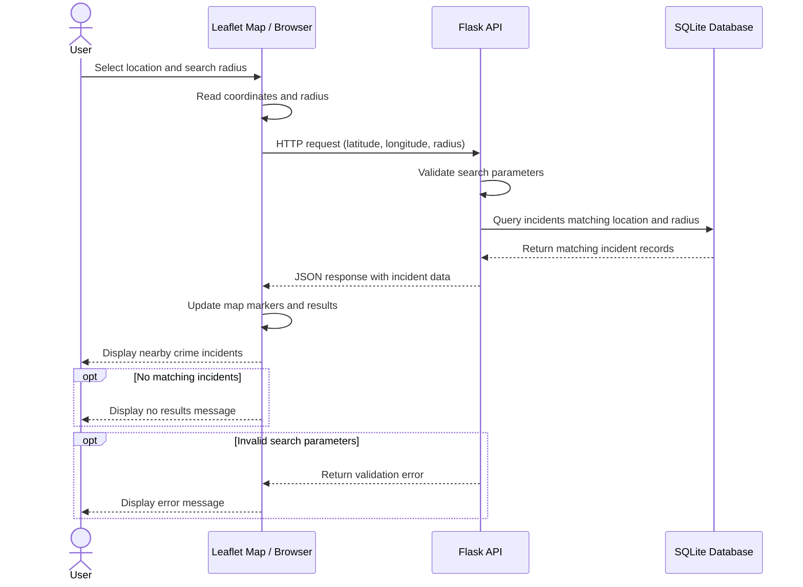

# Sprint 2 — Location Search UML Sequence Diagram
> Epic: #3. Stories: #4, #5. Task: #70
This diagram illustrates the planned interaction when a user searches for crime incidents near a selected location.

**Note:** This is the planned interaction. Exact Flask endpoints, geographic filtering logic, and error handling should be verified against the implemented backend.
