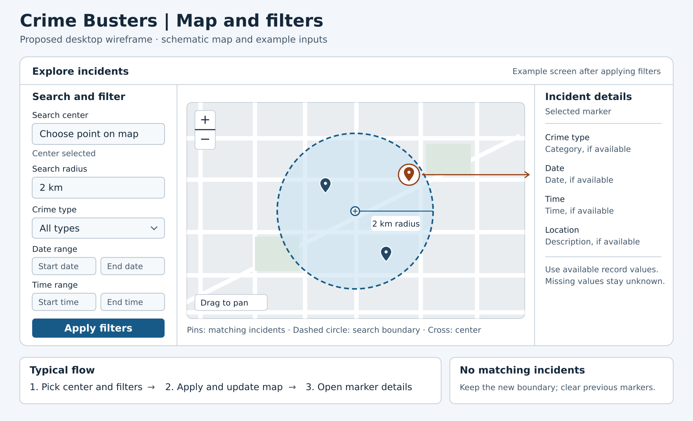

# Design — Map and filters wireframe

> Epic: #12 · Stories: #13, #21, #22 · Task: #80
> Status: proposed desktop design



*Figure 5 — Proposed map page for applying filters and a radius search, then opening a matching incident’s details.*

1. Pick a center on the map, enter a radius, and optionally choose a crime type, date range, or time range.
2. Select **Apply filters**. The map draws the applied search boundary and replaces the markers with matches that have usable coordinates. If there are no matches, keep the new boundary, clear the old markers, and show **No matching incidents**.
3. Select a marker to see the available crime type, date, time, and location description. Leave unavailable values unknown.

The map and values in the figure are illustrative. The 2 km input follows the example in the [radius-search sequence](radius-search-sequence.md); the final distance unit is still a team decision. The wireframe does not assume a geocoder or a specific basemap provider. See the [interactive crime map specification](../specs/crime-map.md) for requirements.

Edit the [SVG source](diagrams/map-filters-wireframe.svg) and regenerate the PNG with:

```sh
inkscape docs/design/diagrams/map-filters-wireframe.svg --export-filename=docs/design/diagrams/map-filters-wireframe.png --export-width=1680
```
