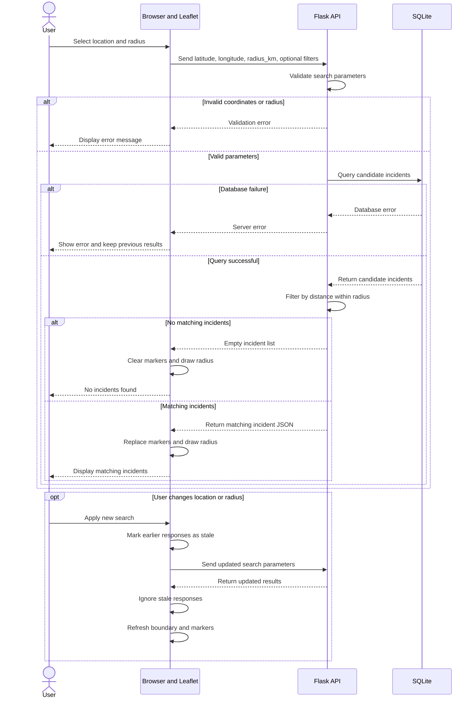

# Sprint 2 — Radius Search UML Sequence Diagram

> Goal 3. Epic: #12. Stories: #22, #21, #13, #28. Task: #70.

**Figure 2. Proposed Crime-Busters radius-search sequence:** A user selects a location and radius, Flask validates and filters incidents from SQLite, and Leaflet displays matching markers and the search boundary.




**Legend:** Solid arrows represent requests and processing steps; dashed arrows represent responses. `alt` indicates alternative outcomes; `opt` indicates an optional interaction.

## Proposed request and response

The API endpoint and final schema remain TBD. The following examples illustrate the intended data exchange, not an implemented contract.

Example request:

```http
GET /api/incidents?lat=34.05&lon=-118.25&radius_km=2&type=theft
```

Example successful response:

```json
{
  "incidents": [
    {
      "id": "example-001",
      "crime_type": "theft",
      "latitude": 34.051,
      "longitude": -118.251,
      "occurred_at": "2026-10-01T14:30:00"
    }
  ]
}
```

## Radius filtering example

For illustration, suppose a user searches within **2 kilometers** of a selected location.

- Incident A is 1.5 km away: included.
- Incident B is 2.0 km away: included if the team adopts an inclusive boundary.
- Incident C is 2.4 km away: excluded.

This diagram proposes kilometers as the request unit and an inclusive boundary (`distance <= radius`). The final units, distance algorithm, and boundary rule require team confirmation.

Flask is proposed to validate inputs and apply geographic filtering to SQLite candidate records. Leaflet is responsible for drawing the selected radius boundary and incident markers.

## Validation, errors, and repeat searches

Invalid or missing latitude/longitude values and missing, nonnumeric, or nonpositive radius values stop processing before a SQLite query. The browser displays a validation message without replacing existing results.

A database or API failure produces a visible error message and preserves the previous map results. A successful query with zero matches clears the old incident markers, draws the new search boundary, and displays a no-results message.

Changing the location, radius, or optional filters initiates a fresh request. The browser should associate responses with the latest request and ignore older, stale responses so previous results cannot overwrite newer ones.

Exact HTTP status codes, endpoint names, error schema, request cancellation strategy, and implementation details are proposed or TBD.

## Scope and traceability

This is a **proposed integration design**, not a claim that the complete radius-search feature is implemented. It should be checked against existing prototypes and the team's architecture decisions.

- Main scope: Goal 3, Epic #12, Story #22 (location/radius search).
- Supporting stories: #21 (filters/API), #13 (Leaflet markers), #28 (storage/retrieval).
- Related design: [Data Flow Diagram](data-flow.md) and [Architecture](architecture.md), Issue #66.
- Related task: #70.
