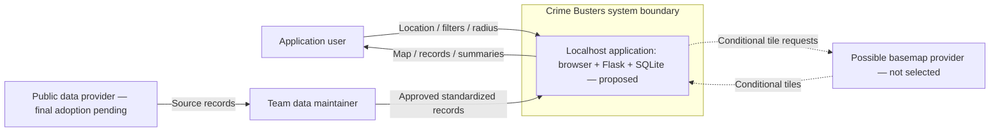
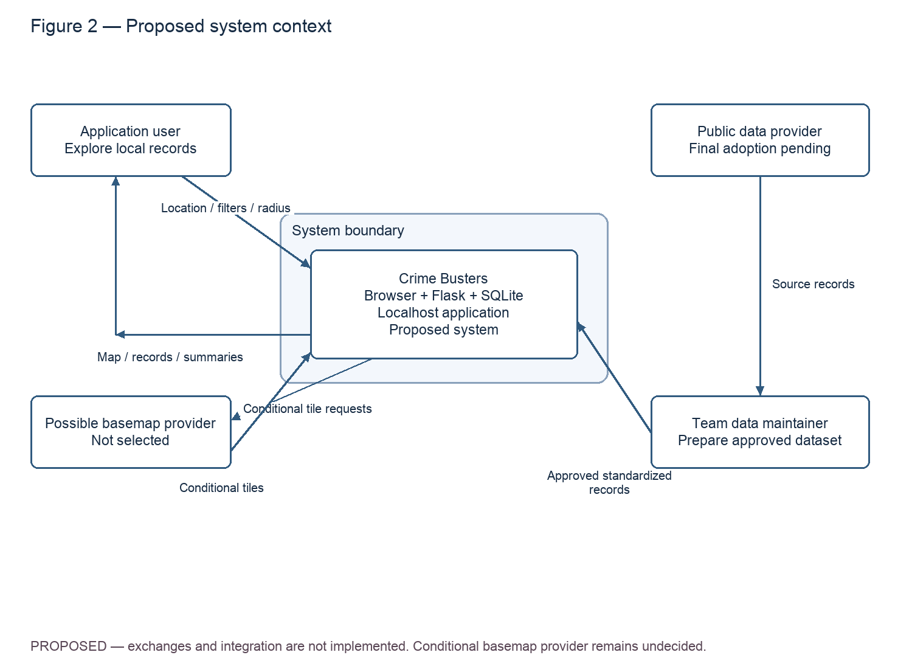

> Epics: #3, #14, #12 · Stories: #4, #5, #28, #15, #16, #13, #21, #22
> Documentation tasks: #66, #60 · Owner: Mike · Status: proposed; independent review pending

# System context

Figure 2 answers who or what is outside Crime Busters. It deliberately treats the browser, Flask application, and SQLite file as one localhost system. Internal components appear in [Figure 1: architecture](architecture.md). This is a context view, not the separate DFD or UML sequence deliverable.

*Figure 2 — Proposed system context. All exchanges are planned; basemap exchanges are conditional and have no adopted provider.*

The application user will select criteria and explore matching records and summaries (Goals #14 and #12). This view assumes no project login requirement: the repository login example is scaffold code. Location selection does not imply device geolocation or address geocoding.

The team data maintainer is a human operational role, not an added service or assigned new team member. This person will acquire source records and run preparation tools under Goal #3. The [source evaluation](../crime-data-sources.md) records an inspected historical Costa Mesa sample, not final source adoption or reuse permission. The [format specification](../crime-data-format.md) defines the standardized exchange and quality rules; normalization, loading, and retrieval remain separate tasks #11, #35, #36. Figure 2's input to the system represents that prepared-data workflow, not a browser upload feature or a direct provider-to-user feed.

Calls for service must be labeled accordingly; missing coordinates cannot support spatial results, and block-level locations cannot imply exact incident positions. The source's timezone, freshness, coverage, and reuse terms require verification. A conditional basemap provider would supply background tiles only; it would not supply the application's incident records. The browser would request those tiles if an external provider is adopted, as shown in Figure 1. Provider selection and offline behavior are unresolved.

No sponsor system, authentication service, predictive model, geocoder, cloud host, or live data integration is established by this context. The diagrams support the locked goals without adding such dependencies. For export instructions see [architecture](architecture.md).
