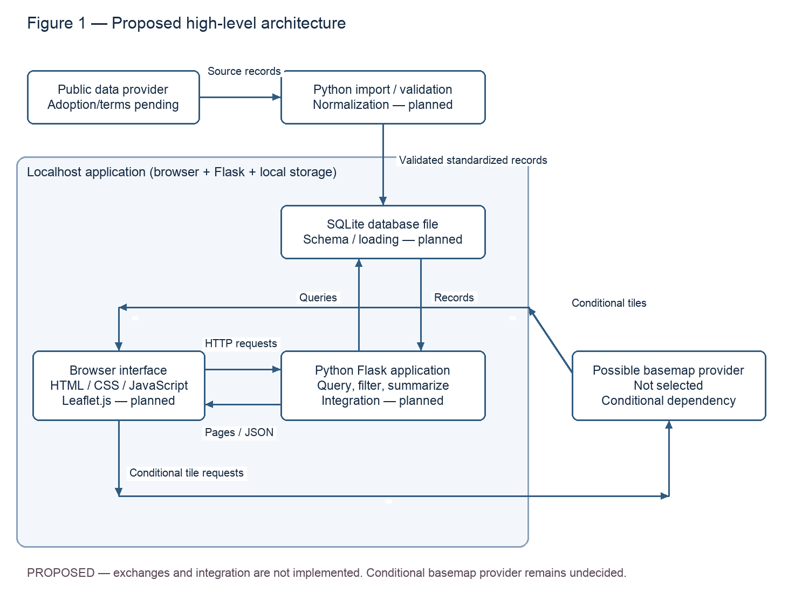
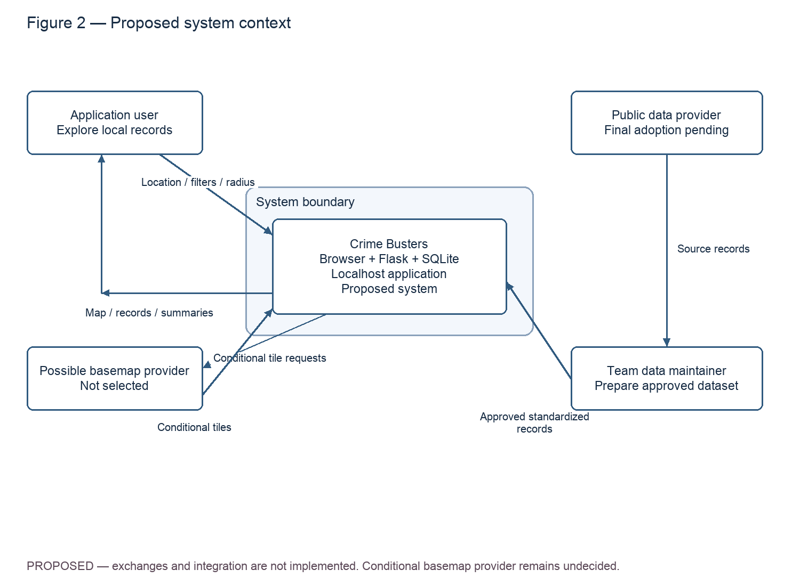
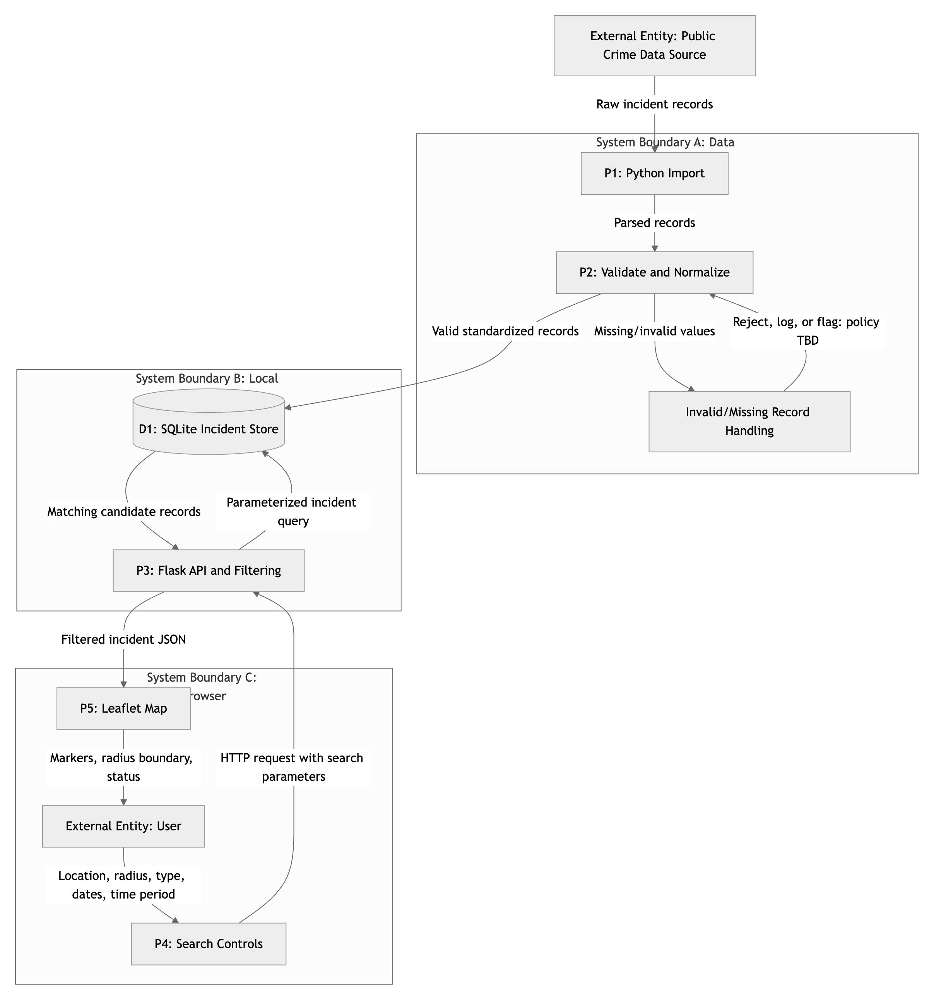
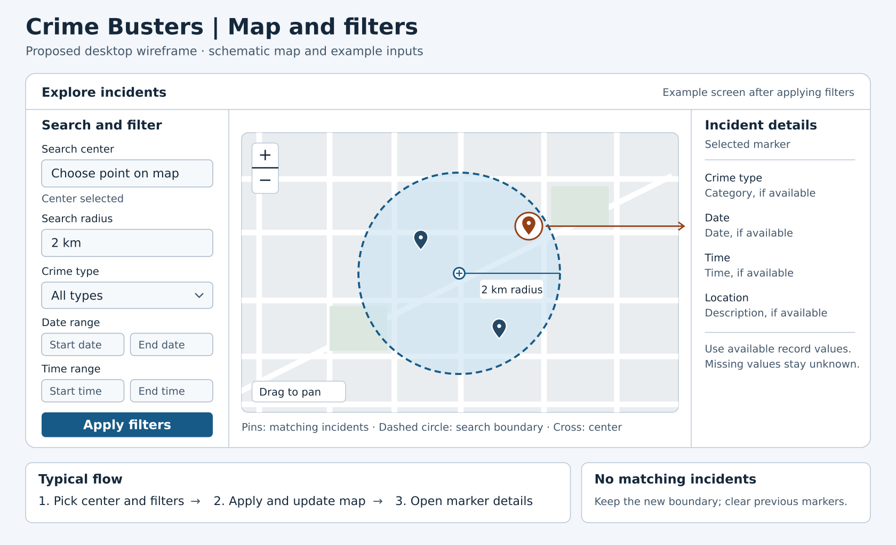
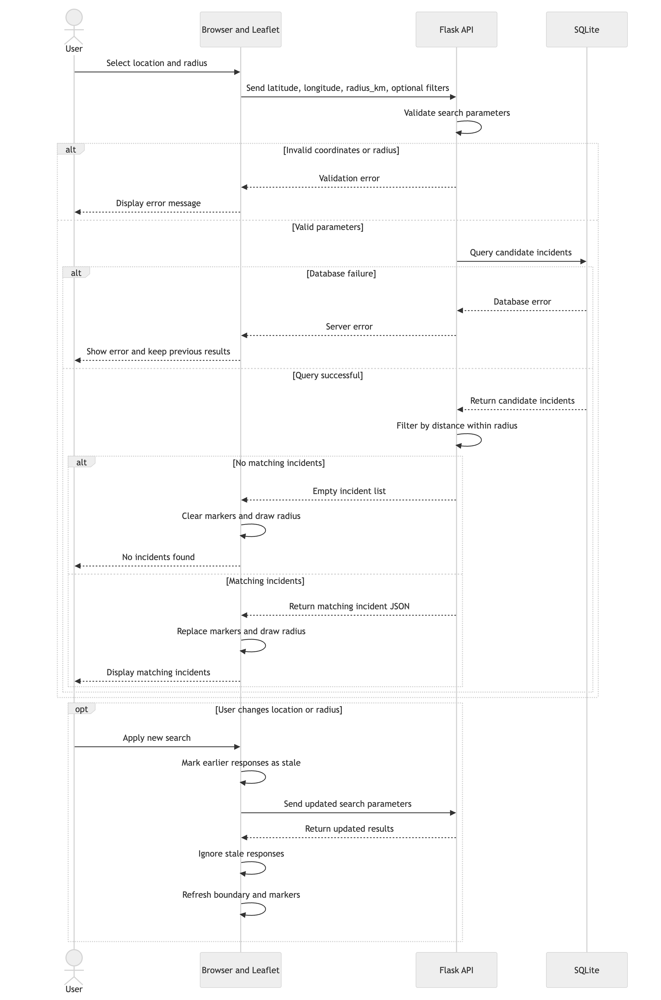

# Project Proposal — Interactive Crime Map and Database

**Department of Computer Science**
**CPSC 490 Undergraduate Seminar in Computer Science — Proposal for Capstone Project**

**Group 08 — Crime Busters** · Sponsor: independent
Authors: Reyes, Alex (alexreyes1-ctrl), Chavez, Julian (jmbchavez), Truong, Mike (miketruong91), Yonnas, Adonay (Abreezy2)
Repository: https://github.com/miketruong91/CPSC490-G08-Crime-Busters
Date: 2026-10-20

> **This file is the proposal document, not a README.** Its section numbers,
> titles, and guidance are copied from the course Word template, so it
> converts cleanly for Canvas submission. Write continuous academic prose —
> no task lists, no emoji, no repo jargon.
>
> Each section below opens with the template's own guidance in a quote block.
> **Delete the quote blocks and every 〈bracket〉 before submitting.**
>
> **Getting this into the Word template for Canvas.** The template numbers
> its headings **automatically** (a multilevel list: top-level sections at
> level 1, *Related Work* and *Problem Statements* at level 2). The numbers
> typed below exist so the repo copy is readable and checkable — so when you
> move the text into Word, do not end up with both sets.
>
> The reliable route, and the one most teams should use: **open the course
> template and paste your prose section by section**, leaving Word's own
> numbering to do the numbering. Ten minutes, no surprises.
>
> To export from the repository root with Pandoc, use the course reference
> document and Lua filter. Export the issue titles first if Appendix A should
> include them. Keep the generated files local.
>
>     gh issue list --state all --limit 1000 --json number,title > proposal/issues.json
>     pandoc proposal/proposal.md -o proposal/proposal.docx --reference-doc=proposal/reference.docx --lua-filter=proposal/to-word.lua --resource-path=proposal
>
> Open the Word export and check the cover fields, section numbering,
> figures, and Appendix A before submitting.
>
> **Formatting requirements — the submitted Word document is graded against
> these, explicitly:**
>
> - **Cover page: use the template's cover page, unchanged in layout.** Fill
>   in only its fields — project title, group number and name, sponsor,
>   authors, date — and keep the template's own placement, fonts and spacing
>   for it. The header block at the top of this file carries the same fields
>   so the paste is a transcription, not a redesign.
> - **Font: Times New Roman, 11-point.** Body text, headings and captions
>   take their size and style from the template's own styles — do not
>   restyle anything by hand.
> - **Line spacing: 1.5.** **Margins: 1.0 inch** on all four sides.
> - **Section format, numbering and indentation must match the Word template
>   exactly** — the multilevel-list numbering, heading levels, and paragraph
>   indentation are the template's, not yours. If your document's §1.1 looks
>   different from the template's §1.1, fix yours.
> - **Length: the Final Project Proposal Paper (due Sun Dec 20) must exceed
>   50 pages** under exactly this formatting — font, spacing and margins are
>   fixed above precisely so page count means the same thing for every team.
>   The Preview paper (due Sun Nov 29) is the same document part-way; it has
>   no minimum, but it is graded on the same formatting.
>
> A paste into the template inherits all of this automatically **if you paste
> as text and let Word's styles apply** (Home → Paste → *Keep Text Only*, or
> apply the template's styles after pasting). A pandoc conversion with
> `--reference-doc` inherits it too — but verify font, spacing and margins
> afterward rather than assuming.
>
> Either way, keep this Markdown copy current — it is what peer review and CI
> can actually read. If your team writes in Word instead, commit the `.docx`
> here as well.

---

## 0. Abstract

Crime happens everywhere, in every community. Access to crime data can help residents stay aware of and understand what's happening in the community. Although the data may be able to be accessed through specific agencies and departments, that data isn’t always shown in a way that’s easy for the public to visualize. The purpose of this project is to create an interactive application that organizes publicly available crime incident data and allows users to search for and view reported incidents of crime within an area. By showing the data through an interactive map, users can gain a better understanding of reported crime activity in their community. This can help users stay more informed about the crime happening in the areas that matter to them.
Our project has three main objectives. The first is to collect publicly available crime data from all possible and credible sources and organize it in a database. The second is to provide users with statistics and other useful information that can help with identifying possible patterns in crime activity. The third is to integrate an interactive map that allows users to explore incidents within a selected area. The expected outcome is a functional application that combines these three goals into one.
This proposal presents the initial design and development plan for our Crime Busters. The project will focus on creating an interactive application that organizes public crime data and makes the information easier for users to explore and understand. The initial goals and objectives will guide the development of key features, including searching, filtering, and viewing reported crime incidents. These goals will also be organized into epics and user stories to guide the team through future development sprints. As the project progresses, the system will be developed and tested incrementally, allowing the team to improve its functionality based on testing, feedback, and project requirements.

## 1. Introduction

Crime data is gathered by law enforcement agencies to document theft, burglary, vandalism, assault, and other reported criminal activity. Some of this information is shared with the public through crime reports, online databases, and other resources. However, crime datasets can contain large numbers of records distributed across different sources. This can make it difficult for users to search the information and understand reported crime activity within a particular area.

The Interactive Crime Map and Database project aims to make crime data easier to discover, filter, and interpret. The proposed system will use selected publicly available crime records and store them in a structured database. Users will be able to view incidents on an interactive map and search or filter the information by location, crime type, date, and time. This will provide a more organized way to explore the selected records.

A central feature of the project is allowing users to select a location and define a custom search radius around it. The system will identify incidents within that radius and provide summaries of crime type, frequency, date, and time. For example, users could examine whether certain reported crime types appear more frequently on particular days or during particular time periods.

The application will combine data organization, geographic searching, filtering, statistical summaries, and crime visualization. Existing applications offer overlapping capabilities, as discussed in Section 1.1. Our project will focus on implementing and testing these functions together for selected public datasets, allowing users to view incidents and summaries for the same area and search criteria.

### 1.1 Related Work

Public crime information is available through municipal applications and broader crime-mapping platforms. We compared Costa Mesa's Police Incidents Viewer, Fullerton's Calls for Service application, and LexisNexis Community Crime Map. The comparison considers their published information, geographic scope, analytical features, and relevance to our planned application.

| Existing approach | What it does | Pros | Cons | Why ours differs |
|---|---|---|---|---|
| Costa Mesa Police Incidents Viewer [1] | Presents police calls for service through geographic layers organized by incident category and recent time periods, including the past 24 hours, 3 days, 7 days, and 14 days. | Official municipal source with geographic information and a structured ArcGIS service. | The documented layers focus on recent Costa Mesa activity; calls include non-crime categories and require careful interpretation. | Our project plans to standardize selected records in a database and connect custom-radius searches with category and time summaries. |
| Fullerton Police Calls for Service [2] | Publishes call records with incident numbers, call descriptions, timestamps, and block-level locations. | Official local source with details useful for examining individual calls. | Calls include non-crime activity, and block-level locations limit geographic precision. | Our project plans to connect selected records with map-based exploration, combined filters, and summaries for a selected area. |
| LexisNexis Community Crime Map [3], [4] | Provides agency-supplied crime information through maps, grids, charts, and analytics, with neighborhood reports and anonymous tips. | Combines geographic and statistical views and receives data directly from law enforcement agencies. | Public information depends on what agencies choose to share; privacy processing limits some location and personal details. | Our project has a narrower scope focused on implementing and testing a documented data-processing workflow, radius searches, filters, and summaries for selected datasets. |

The municipal applications provide local police activity information, while Community Crime Map combines incident mapping with analytical views. This comparison shows that maps and statistics alone do not distinguish our proposal. Our project will focus on connecting data standardization, custom-radius searches, combined filters, and summaries of the same selected incidents in a smaller application. We will evaluate whether these functions return consistent and correct results using documented test datasets.

Calls for service must also be distinguished from confirmed crimes. If a selected source contains both crime-related and other service activity, our data-processing rules will document how those categories are interpreted and included.

### 1.2 Problem Statements

**P1 — Inconsistent data formats:** Publicly available records may use different field names, date and time formats, and incident categories across sources. These differences make records difficult to organize and compare consistently.

**P2 — Difficulty interpreting selected-area activity:** Individual incident records do not directly summarize crime-type frequencies or changes over time within an area selected by the user. Users must perform additional analysis to identify these patterns.

**P3 — Difficulty narrowing records to an area of interest:** Users need to identify records relevant to a chosen location, distance, crime type, date, and time period. Reviewing broader collections of records makes this task more difficult.

| Problem | Addressed by |
|---|---|
| P1 — Inconsistent data formats | Goal 1: Establish a reliable and structured crime data foundation; Objectives 1.1–1.3 |
| P2 — Difficulty interpreting selected-area activity | Goal 2: Identify possible crime patterns; Objectives 2.1–2.2 |
| P3 — Difficulty narrowing records to an area of interest | Goal 3: Integrate an interactive map for exploring incidents within a selected area; Objectives 3.1–3.3 |

## 2. Goals and Objectives

### Goal 1: Establish a reliable and structured crime data foundation for the application.
[[epic:#3]](https://github.com/miketruong91/CPSC490-G08-Crime-Busters/issues/3)

Public records are published with different names, formats, and levels of detail. A common format lets the application retrieve records consistently while preserving where they came from and what the source actually reported. Keeping quality flags and location precision also lets later features explain gaps in the data.

- **Objective 1.1:** Collect publicly available crime records containing crime type, location, date, and time, with the data source and minimum record count to be confirmed after reviewing available datasets.
  [[story:#4]](https://github.com/miketruong91/CPSC490-G08-Crime-Busters/issues/4)

- **Objective 1.2:** Organize collected crime records into a consistent format for crime type, location, date, and time, verifying that each record meets the documented format or is flagged for correction.
  [[story:#5]](https://github.com/miketruong91/CPSC490-G08-Crime-Busters/issues/5)

- **Objective 1.3:** Store standardized crime records in the database and verify that the stored record count and retrieved information match the records loaded.
  [[story:#28]](https://github.com/miketruong91/CPSC490-G08-Crime-Busters/issues/28)

### Goal 2: Identify possible crime patterns.
[[epic:#14]](https://github.com/miketruong91/CPSC490-G08-Crime-Busters/issues/14)

A list of individual reports makes it hard to see which categories or time periods account for most of the records. Counts and charts will describe the user's current selection and make it possible to compare groups within it. Coverage and missing information affect how those counts should be interpreted.

- **Objective 2.1:** Analyze crime incidents within the selected area by crime type, date, and time, verifying that the frequency counts match manually calculated results from a test dataset.
  [[story:#15]](https://github.com/miketruong91/CPSC490-G08-Crime-Busters/issues/15)

- **Objective 2.2:** Provide the total incident count, counts by crime type, and charts summarizing crime activity in the selected area, with displayed values matching the corresponding database query results.
  [[story:#16]](https://github.com/miketruong91/CPSC490-G08-Crime-Busters/issues/16)

### Goal 3: Integrate an interactive map that allows users to explore crime incidents within a selected area.
[[epic:#12]](https://github.com/miketruong91/CPSC490-G08-Crime-Busters/issues/12)

Users need a way to focus on an area that matters to them and then inspect individual records. A map will combine navigation, marker details, and a visible search boundary with incident filters. The same selection will drive the map and the summaries described in Goal 2.

- **Objective 3.1:** Display crime incidents as interactive map markers showing available crime type, date, and time details, with the response-time target and test dataset size to be confirmed after selecting the dataset.
  [[story:#13]](https://github.com/miketruong91/CPSC490-G08-Crime-Busters/issues/13)

- **Objective 3.2:** Allow users to search and filter crime incidents by location, crime type, date range, and time period, verifying that individual and combined filters return the expected records from a test dataset.
  [[story:#21]](https://github.com/miketruong91/CPSC490-G08-Crime-Busters/issues/21)

- **Objective 3.3:** Allow users to select a location and adjust a custom search radius, verifying with known test locations that incidents inside or on the boundary are included and incidents outside the radius are excluded.
  [[story:#22]](https://github.com/miketruong91/CPSC490-G08-Crime-Busters/issues/22)
  
## 3. Proposed Approaches

The proposed strategy is to build a traceable data-to-map workflow in small, testable increments. For Goal 1, the team will evaluate a public source, validate its fields and limitations, convert records into a consistent format, and verify storage and retrieval. A reviewed local dataset will make demonstrations repeatable while keeping source identity, missing values, and location precision visible. Calls for service will retain that label rather than being presented as confirmed crimes. Source adoption and reuse terms remain open; §4 links the current evaluation and format specification.

For Goal 2, the application will select records within a user-defined area and summarize their frequencies by category, date, and time. These descriptive summaries will help users explore possible patterns in the available records. They will not establish causation or predict individual crimes. The existing area-filtering and frequency modules provide a starting point; connecting them to standardized records, storage, and the interface remains planned work.

For Goal 3, users will explore mapped records, inspect incident details, and narrow results using location, category, date/time, and radius controls. Map results and summaries should use the same selected records so that the two views agree. The team will first connect a small verified dataset to the map, then add and test the remaining interactions incrementally. The implementation stack and component boundaries are detailed in §4.

Possible alternatives include requesting live provider data on every search or importing a reviewed snapshot before querying locally. Live requests could provide newer data but depend on provider availability, update frequency, and access terms that have not been verified. Local snapshots support repeatable testing, but their age and coverage must be disclosed. The latter is the proposed initial approach, subject to source approval. Similarly, descriptive counts are a smaller, more explainable starting point than predictive modeling, whose data and evaluation requirements have not been established. These are proposal trade-offs for team review, not a record of completed experiments or undocumented team decisions.

## 4. Required Environment, Resources, and Planned Activities

The Crime Busters project requires access to publicly available incident records, a development environment for data processing and testing, a database for storing standardized records, and a web-based map interface. The team will use its shared GitHub repository to maintain source code, technical documentation, issues, and pull requests. Development will proceed in small increments so that data ingestion, area filtering, summaries, and map presentation can be verified separately before integration.

### Required environment and resources

The localhost prototype uses Python, Flask, SQLite, and a Leaflet page written in HTML, CSS, and JavaScript. Python normalizes source records and loads SQLite. Flask serves the browser page and retrieves mappable records from the local database. The standalone Python area and frequency modules will support later search and summary integration.

Team members need Python, Git, and a modern browser. The [prototype setup guide](../prototype/README.md) explains how to create a virtual environment, install the pinned Flask dependency, build the demo database, start the app, and run pytest. Setup is tracked in [[task:#83]](https://github.com/miketruong91/CPSC490-G08-Crime-Busters/issues/83). SQLite runs without a separate database server. Installing dependencies and loading the demo’s remote Leaflet assets and basemap tiles require network access. Offline behavior and basemap terms for broader use remain open.

Goal 1's [Crime Data Sources](../docs/crime-data-sources.md) documents the inspected Costa Mesa Burglary layer 57 response: 19 historical calls for service, with block-level locations. Final adoption, reuse terms, timezone, and update frequency remain unresolved. [Standardized Crime Data Format](../docs/crime-data-format.md) defines the UTF-8 JSON exchange format, source identifiers, nullable fields, coordinate validation, quality flags, and duplicate handling. The SQLite schema, Costa Mesa layer 57 normalizer, loader, and verification logic are on develop ([PR #73](https://github.com/miketruong91/CPSC490-G08-Crime-Busters/pull/73)). The layer 57 sample supports the repeatable local-snapshot approach in §3. Final dataset adoption and reuse terms still require team confirmation. Unusable coordinates must be excluded from spatial results; missing fields cannot participate in filters that require them. Source values must remain traceable and must not be invented.

### Architecture and system context diagrams

Figure 1 shows the proposed components and localhost boundary. The browser will request pages and submit search criteria to Flask, which will query SQLite and apply filtering/analysis before returning records and summaries. Import and normalization will be a separate preparation step, not a provider request on every user search. The demo uses the read-only incident route described below. Search request parameters and response formats still need design. The authoritative [architecture design and editable Mermaid](../docs/design/architecture.md) explain each exchange and its implementation status.

*Figure 1 — Proposed high-level architecture; arrows describe planned exchanges, not implemented interfaces.*

Figure 2 treats Crime Busters as one system and shows its external actors. A team data maintainer will prepare approved records; a user will explore the application. A possible external basemap dependency remains conditional until a provider is selected. The [system context design and editable Mermaid](../docs/design/system-context.md) define this boundary.

*Figure 2 — Proposed system context; the conditional basemap arrows do not imply an adopted provider.*

[Figure 3 — Initial SQLite entity relationship model](https://github.com/miketruong91/CPSC490-G08-Crime-Busters/blob/develop/docs/design/crime-database-er.md#entity-relationship-diagram). Each standardized incident can have zero or more quality flags. The model and schema were delivered in [PR #73](https://github.com/miketruong91/CPSC490-G08-Crime-Busters/pull/73).

The SQLite schema gives each incident an internal integer key and enforces uniqueness on the pair of source and source record ID. The source record ID stays text to preserve leading zeros. Each associated flag uses the incident key and flag name together as its key. Separate nullable date, time, timezone, and coordinate fields let the database preserve incomplete records while downstream filters exclude them when the relevant value is unavailable. The source classification and location precision travel with the record so the application can distinguish a block-level call for service from a precise, confirmed incident.

### Data flow and radius search

The import path validates and normalizes source records before storing accepted records in SQLite. Missing values and conflicting records are handled under format v1. In the proposed search path, the browser passes the user's criteria to Flask. Flask retrieves candidate records from SQLite and sends matching records to Leaflet. This separation makes a saved input reusable across searches. See [[task:#69]](https://github.com/miketruong91/CPSC490-G08-Crime-Busters/issues/69) and [PR #71](https://github.com/miketruong91/CPSC490-G08-Crime-Busters/pull/71).

*[Figure 4 — Proposed data flow from source snapshot to map](https://github.com/miketruong91/CPSC490-G08-Crime-Busters/blob/develop/docs/design/data-flow.md).*

### Map and filters wireframe

Figure 5 shows how a user selects a center, applies radius and incident filters, and opens a matching marker in the detail panel. The [editable design and interaction notes](../docs/design/map-filters-wireframe.md) are tracked in [[task:#80]](https://github.com/miketruong91/CPSC490-G08-Crime-Busters/issues/80).

*Figure 5 — Proposed map and filters wireframe. The no-results state keeps the applied boundary and clears old markers.*

Figure 6 proposes that Flask validate the center, radius, and active filters before querying SQLite. On success, the browser replaces the previous markers and redraws the applied boundary. Zero matches clear the markers and show a message. Errors preserve the last successful result with a visible error message, and an older response cannot replace a newer one. The sequence illustrates a possible request in kilometers. The current filter works in miles and includes boundary points, so the request and map-drawing units must be made consistent during integration. See [[task:#70]](https://github.com/miketruong91/CPSC490-G08-Crime-Busters/issues/70) and [PR #71](https://github.com/miketruong91/CPSC490-G08-Crime-Busters/pull/71).

*[Figure 6 — Proposed radius-search request and response sequence](https://github.com/miketruong91/CPSC490-G08-Crime-Busters/blob/develop/docs/design/radius-search-sequence.md).*

### Goal 1 requirements and planned activities

The initial scope covers evaluating a public source, saving a local snapshot, normalizing it to the [standardized format](../docs/crime-data-format.md), and retrieving standardized records from SQLite. Source evaluation must document the publisher, access method, fields, and known limits. The normalizer must produce all 17 exchange fields for accepted records and preserve source identity, nullable values, and quality flags. It must hold records with missing required identifiers or conflicting duplicates. Repeated loads of identical input must leave stored values and counts unchanged. Raw and generated data stay local while reuse terms are unresolved.

The [Goal 1 specification](../docs/specs/crime-data-foundation.md) defines acceptance against a saved input with known field mappings, missing values, leading-zero IDs, and duplicate cases. On a fresh database, the stored count must equal the number of unique accepted records, and retrieval must reproduce their standardized values and flags. The application must then demonstrate that it can retrieve those fields and preserve source classification and quality information for downstream use.

Source evaluation and field verification are tracked in [[task:#8]](https://github.com/miketruong91/CPSC490-G08-Crime-Busters/issues/8), [[task:#9]](https://github.com/miketruong91/CPSC490-G08-Crime-Busters/issues/9). The checked sample contains 19 historical Costa Mesa burglary calls for service. It is evidence for the pipeline, with final source adoption, minimum dataset size, reuse terms, timezone, location accuracy, and refresh frequency still open. The exchange format, normalizer, schema, loader, and verification are tracked in [[task:#10]](https://github.com/miketruong91/CPSC490-G08-Crime-Busters/issues/10), [[task:#11]](https://github.com/miketruong91/CPSC490-G08-Crime-Busters/issues/11), [[task:#32]](https://github.com/miketruong91/CPSC490-G08-Crime-Busters/issues/32), [[task:#35]](https://github.com/miketruong91/CPSC490-G08-Crime-Busters/issues/35), [[task:#36]](https://github.com/miketruong91/CPSC490-G08-Crime-Busters/issues/36). The next step is to confirm the evaluation dataset and verify retrieval through the application. The written specification for this goal and Goal 2 was delivered under [[task:#79]](https://github.com/miketruong91/CPSC490-G08-Crime-Busters/issues/79).

### Goal 2 requirements and planned activities

Goal 2 covers descriptive summaries for the selected records. The application must use the same selection for map results, totals, category counts, and date and hour-of-day charts. The circular filter must use the documented distance calculation, include boundary points, and skip unusable coordinates. A record with a missing category, date, or time still contributes to the selection total and is omitted from the affected grouping. Identical inputs must produce reproducible results, and the display must explain incomplete coverage and distinguish calls for service from confirmed crime records.

The [Goal 2 specification](../docs/specs/crime-pattern-analysis.md) requires comparison against hand-calculated totals and groups for a fixture with inside, boundary, outside, and unusable-coordinate records. Tests must also cover an empty selection, missing grouping fields, and standardized date and time fields. In the integrated application, chart values and totals must agree with the database-backed selection used to populate the map.

The standalone area and frequency functions are available under [[task:#17]](https://github.com/miketruong91/CPSC490-G08-Crime-Busters/issues/17), [[task:#18]](https://github.com/miketruong91/CPSC490-G08-Crime-Busters/issues/18). Integration must map `incident_date` and `incident_time` to the analysis interface or update that interface explicitly. Totals and chart presentation follow in [[task:#19]](https://github.com/miketruong91/CPSC490-G08-Crime-Busters/issues/19), [[task:#20]](https://github.com/miketruong91/CPSC490-G08-Crime-Busters/issues/20). Reporting timezone, treatment of incomplete date/time values and canceled calls, chart forms, and the performance test dataset and target remain open.

### Goal 3 requirements and planned activities

Goal 3 covers a desktop browser map with pan and zoom, selectable markers, and combined location, category, date, and time filters. Users must be able to choose a center and radius, see the applied circle, and inspect the available details for a marker. Controls must identify the distance unit clearly. Markers and radius results require usable coordinates. The map must show source-provided details and indicate when values are unavailable. Live tracking, report submission, and emergency alerts are outside the planned scope.

Acceptance under the [Goal 3 specification](../docs/specs/crime-map.md) and [[task:#68]](https://github.com/miketruong91/CPSC490-G08-Crime-Busters/issues/68) requires a known dataset that demonstrates pan and zoom, correct marker details, individual filters and their intersection, inclusion of boundary records, exclusion of invalid locations, and the no-results state shown in Figure 5. Repeat searches must update the boundary and marker set together. A search failure must leave the last successful result visible and explain the failure.

The initial Flask and Leaflet demo serves the map and retrieves SQLite records. The map setup and data connection are tracked in [[task:#23]](https://github.com/miketruong91/CPSC490-G08-Crime-Busters/issues/23), [[task:#24]](https://github.com/miketruong91/CPSC490-G08-Crime-Busters/issues/24). The demo groups records at shared coordinates into selectable markers. The broader marker work is tracked in [[task:#27]](https://github.com/miketruong91/CPSC490-G08-Crime-Busters/issues/27). Filter controls and result updates are tracked in [[task:#29]](https://github.com/miketruong91/CPSC490-G08-Crime-Busters/issues/29), [[task:#30]](https://github.com/miketruong91/CPSC490-G08-Crime-Busters/issues/30), [[task:#31]](https://github.com/miketruong91/CPSC490-G08-Crime-Busters/issues/31), and center selection and boundary display under [[task:#33]](https://github.com/miketruong91/CPSC490-G08-Crime-Busters/issues/33), [[task:#34]](https://github.com/miketruong91/CPSC490-G08-Crime-Busters/issues/34). Basemap terms for broader use, offline behavior, the search API contract, displayed radius units and bounds, and the desktop performance target still need agreement.

### Implemented modules and verification

For Goal 1, [the normalizer](../prototype/normalize.py) converts the bundled Costa Mesa layer 57 snapshot into standardized JSON. Its tests check missing and invalid values, leading-zero identifiers, and duplicate handling against the exchange format. [The schema](../prototype/schema.sql) and [loader](../prototype/load_db.py) store records and their quality flags in SQLite. Loader tests check stored counts and retrieved values, verify that a repeat load leaves the database unchanged, and detect conflicting records or changes to stored data.

For Goal 2, [the area filter](../prototype/area_filter.py) selects records by Haversine distance in miles. Its tests cover inside, outside, and boundary points, zero radius, and invalid coordinates. [The frequency module](../prototype/crime_frequency.py) returns a total and groups by type, date, and hour of day. Its tests compare counts with expected values and confirm that missing grouping values do not remove records from the total. These tests verify the module behavior on fixtures. Comparing charts and totals with the same database-backed map selection remains an integration check.

For Goal 3, [the Flask app](../prototype/app.py) serves the Leaflet page at `/` and reads SQLite in read-only mode through `/api/incidents`. The endpoint returns records with valid coordinates. The page groups them into markers and shows the associated calls when a marker is selected. [PR #84](https://github.com/miketruong91/CPSC490-G08-Crime-Busters/pull/84) records a fresh-clone check in which the loader verified 19 records, the map showed 13 mapped locations, both routes returned HTTP 200, and all 51 existing tests passed. These checks cover loading and display for the bundled sample. Automated route and browser checks for combined filters, radius boundaries, empty results, and synchronized summaries remain to be implemented.

### Design decisions and unresolved interfaces

The [ER design](../docs/design/crime-database-er.md), [data flow](../docs/design/data-flow.md), and [radius-search sequence](../docs/design/radius-search-sequence.md) describe the model and planned exchanges. The [architecture](../docs/design/architecture.md) and [system context](../docs/design/system-context.md) are tracked under [[task:#66]](https://github.com/miketruong91/CPSC490-G08-Crime-Busters/issues/66). SQLite keeps deployment local and allows a clean database to be rebuilt from a reviewed snapshot. A separate database server would add setup and administration for the current single-machine prototype. Fetching source data on each search was deferred because results would depend on provider uptime, refresh schedules, and reuse terms. Snapshot age and coverage will need to be visible in the application. Descriptive counts were chosen for the first release because they can be verified against the selected records. Prediction would require a separate dataset and validation plan.

Search parameters and errors, the storage-to-analysis adapter, and chart layout still require design. The next integrated acceptance check will compare matching map records and summaries from the same search. The §4 draft was tracked in [[task:#60]](https://github.com/miketruong91/CPSC490-G08-Crime-Busters/issues/60), and the §3 approach in [[task:#65]](https://github.com/miketruong91/CPSC490-G08-Crime-Busters/issues/65).

The team repository and earlier proposal sections are documented in [[task:#42]](https://github.com/miketruong91/CPSC490-G08-Crime-Busters/issues/42), [[task:#49]](https://github.com/miketruong91/CPSC490-G08-Crime-Busters/issues/49), [[task:#51]](https://github.com/miketruong91/CPSC490-G08-Crime-Busters/issues/51), [[task:#53]](https://github.com/miketruong91/CPSC490-G08-Crime-Busters/issues/53), [[task:#58]](https://github.com/miketruong91/CPSC490-G08-Crime-Busters/issues/58). The separate Sprint 1 retrospective is tracked in [[task:#62]](https://github.com/miketruong91/CPSC490-G08-Crime-Busters/issues/62).

## 5. Project Outcomes

> Describe the outcomes or deliverables, e.g., final project report, user
> manuals, source code, data or database files, etc.
>
> Note: the deliverables always include the team GitHub repository, which
> must already contain prototype v0 (a thin end-to-end proof-of-concept,
> however small, running when this proposal is submitted). Briefly describe
> what your v0 demonstrates and how to run it.

The project will deliver source code, setup instructions, a documented data format, and a local web application for exploring reported incidents. The final demonstration will show users selecting a location, applying filters, and comparing map markers with summaries of the same records. The current browser demo displays historical calls for service from the bundled SQLite snapshot. The setup guide linked in §4 explains how to build the database and run the demo. The remaining integration work covers radius selection, combined filters, and summaries.

## 6. Project Timeline

> Identifies tasks (project objectives) to be performed, milestones to be
> met, and the estimated number of hours for each task.

For CPSC 491, the implementation sequence begins with source approval and a verified import into SQLite. The next milestone is a working browser map backed by stored records. Combined filters, radius search, and summaries follow, then end-to-end acceptance testing and setup verification. This sequence assumes access to an approved source and a development machine that can run the local stack. Spring dates and estimated hours are pending team planning.

## 7. AI Usage

> Per the course AI policy (see the syllabus, Use of AI Tools), disclose the
> AI tools used in preparing this proposal and the prototype: which tools,
> for what tasks (e.g., code generation, test writing, debugging,
> diagramming), and approximately what fraction of each artifact was
> AI-assisted.
>
> Reminder: the prose of this proposal must be your own writing. You remain
> fully responsible for the correctness of all AI-assisted work, including
> the prototype code.

For this Sprint 2 draft, ChatGPT (OpenAI) drafted substantially all new text in §3 and the revised portions of §4, both Mermaid diagrams, and their static figure exports (approximately 100% AI-assisted initial drafting of these changes). It compared claims against `develop`, Goal 1 source/format documentation, issue requirements, and prototype code, and ran repository checks and existing tests as recorded in the pull request. This is automated verification, not human authorship or approval. Mike and an independent teammate must verify the content, rewrite proposal prose in their own words as required by the course, and take responsibility before submission. This disclosure covers this change only; the team must complete disclosure of other proposal and prototype contributions separately.

For the November 9 checklist follow-up, ChatGPT drafted the additions to §2 and the revised §4 prose and removed the printable scaffolding from §§5–6. The initial wording of these changes is approximately 100% AI-assisted. The design figures are existing team artifacts. The team must review the claims and revise the prose in its own words before submission.

After PR #84, ChatGPT drafted the proposal updates describing the runnable prototype and comparing the existing tests with the acceptance criteria. The new prose is AI-assisted and should be reviewed and revised by the team before submission.

## 8. References

- [1] City of Costa Mesa, “PoliceIncidents (MapServer),” ArcGIS REST Services Directory.
https://apps.costamesaca.gov/gis1/rest/services/PoliceIncidents/MapServer
Accessed: October 20, 2026.

- [2] City of Fullerton, “Fullerton Police Calls for Service.”
https://www2.cityoffullerton.com/webdata/apps/cfs/
Accessed: October 20, 2026.

- [3] LexisNexis Risk Solutions, “Community Crime Map.”
https://risk.lexisnexis.com/products/community-crime-map
Accessed: October 20, 2026.

- [4] LexisNexis Risk Solutions, “Crime Analytics and Mapping.”
https://risk.lexisnexis.com/law-enforcement-and-public-safety/crime-analytics-and-mapping
Accessed: October 20, 2026.
